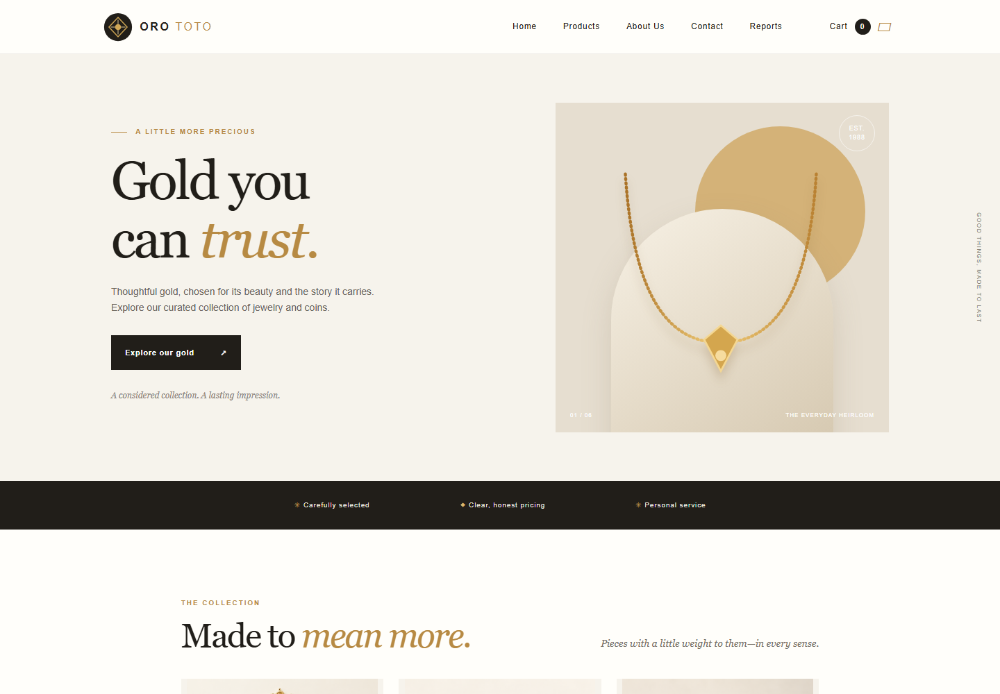
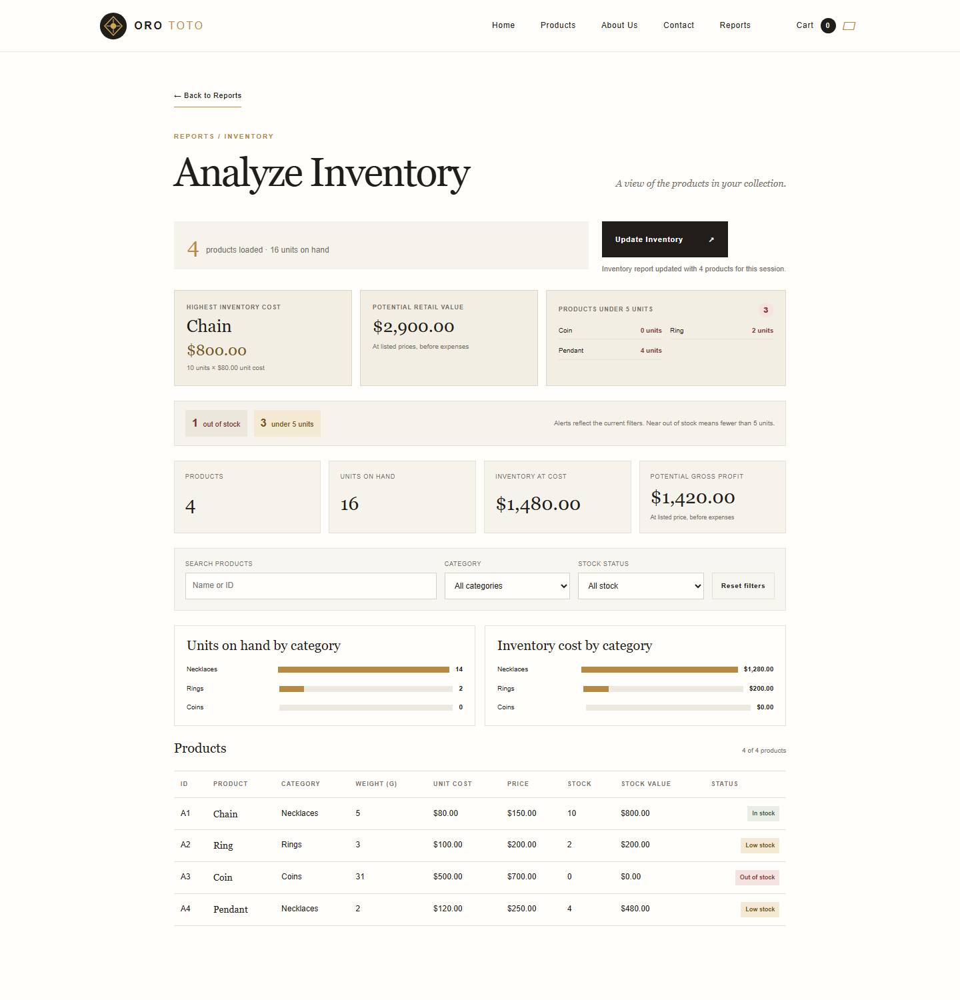
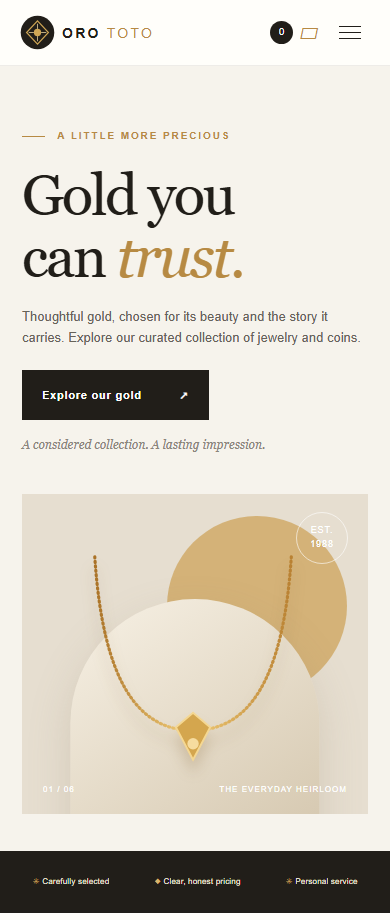

<div align="center">
  
  <h1>Oro Toto</h1>
  <p><strong>A little gold. A lot of possibility.</strong></p>
  <p>A storefront and inventory dashboard built with OpenAI Codex.<br />A basic MVP to inspire you to create your own websites.</p>
  <p>
    <a href="#get-started">Get started</a> ·
    <a href="#take-a-look">Screenshots</a> ·
    <a href="#make-it-your-own">Make it your own</a> ·
    <a href="#hosting">Hosting</a> ·
    <a href="LICENSE">MIT License</a>
  </p>
</div>



## From an idea to a working website

Oro Toto is a fictional gold-jewelry and coin shop: a small, working example of what you can create with **OpenAI Codex**. It combines a responsive storefront, an order-request flow, and an inventory dashboard in one project.

This is a **basic minimum viable product (MVP)** built to learn, experiment, and inspire. Explore the code, try the features, then use it as a starting point for your own shop, portfolio, or business website. The products, brand story, and contact details shown on the website are demonstration content.

> **New to AI? Get trained.**
>
> Want to learn how to create your own websites with AI? Contact [albertcapacitaciondigital@gmail.com](mailto:albertcapacitaciondigital@gmail.com).

## What it does

| Feature | What you can try |
| --- | --- |
| **Responsive storefront** | Browse a sample collection with product images, gold purity, and USD prices on desktop or mobile. |
| **Shopping cart** | Add products, review quantities and subtotal, and submit an order request with your name and email. |
| **Saved orders** | Store orders and item-price snapshots in SQLite locally or Cloudflare D1 when hosted. Repeated requests reuse the saved order. |
| **Price confirmation** | If a price changes before submission, review the updated cart and submit again to confirm. |
| **Email notifications** | Send an order notification through Formspree after saving. Retry a failed notification without creating another order. |
| **Inventory dashboard** | Upload a CSV to explore stock levels, inventory cost, potential retail value, potential gross profit, and category charts. |
| **Search and filters** | Find inventory products by name or ID, category, and stock status, including products with fewer than five units. |
| **Contact-form demo** | Try the contact form's feedback; this separate form does not send messages. |

**MVP scope:** checkout requests do not collect payments. There are no customer accounts, order-management screens, or automatic stock deductions. Inventory uploads are separate from the storefront catalog.

## Take a look

### The collection


### Inventory at a glance



<details>
  <summary><strong>See the mobile storefront</strong></summary>
  <p></p>
</details>

Screenshots show the actual frontend with synthetic sample products and inventory. No customer data is shown.

## Get started

You need **Node.js 22.13 or newer**, with built-in `node:sqlite`, and Git to clone the repository. The local app requires no npm installation, frontend build, or separate SQLite installation. Development tests and the hosted build have their own dependencies.

```powershell
git clone https://github.com/albertcapacitacion/orototo.git
cd orototo
```

### First run: a fresh checkout

The working database is deliberately excluded from Git. Run these setup commands **only for a new installation**:

```powershell
node database/create-local.mjs
node database/prepare-local.mjs --confirm-images-and-visibility
node server.mjs
```

The first command creates a new sample database and refuses to overwrite an existing file. The second makes a backup, assigns the supplied images, and makes the four sample products visible. **It changes the sample database**; skip both setup commands when using an existing installation unless you intend those maintenance changes. See the [database guide](database/README.md) for details.

Open **[http://localhost:5173](http://localhost:5173)**. Stop the server with `Ctrl+C`.

### Returning to the project

```powershell
node server.mjs
```

On Windows, you can also double-click `start-server.bat`. Frontend changes reload the browser automatically; restart the server after backend changes. The local server listens on loopback only.

If port 5173 is occupied, choose another port in PowerShell:

```powershell
$env:PORT = "5180"
node server.mjs
```

## How to use it

### Browse and request an order

1. Open **Products** and add a few sample items to the cart.
2. Open the cart and review the selection and subtotal.
3. Enter a name and email, then choose **Submit order request**.
4. Read the confirmation: saving the order and sending its email notification are separate steps.

**Submitting writes an order to the configured database and can send a real email.** Before trying checkout in your own copy, replace the Formspree endpoint in the cart form in `index.html` with your own endpoint, or use the [isolated browser tests](tests/README.md), which mock email delivery. The contact form elsewhere on the page is demonstration-only.

The cart and notification retry controls live in the open tab. Refreshing loses that state, while saved orders remain in the database. Retrying uncertain email delivery can produce duplicate notifications for the same order.

### Explore inventory

1. Choose **Reports → Analyze Inventory**.
2. Save the example below as a `.csv` file, or prepare your own file with the same headers.
3. Choose **Update Inventory** and select the file.
4. Explore the indicators, category charts, search, and filters. Use **Reset filters** to see all rows again.

```csv
ID,Product,Category,Purity,Weight_g,Cost_USD,Price_USD,Stock
A1,Chain,Necklaces,14K,5,80,150,10
A2,Ring,Rings,18K,3,100,200,2
A3,Coin,Coins,24K,31,500,700,0
A4,Pendant,Necklaces,18K,2,120,250,4
```

Use numeric values without currency symbols. **Each valid upload replaces the report inventory for the current tab session.** Invalid uploads preserve the current report. Navigating between pages keeps the report; refreshing or closing the tab clears it. CSV uploads do not update the product catalog or stored orders. Potential gross profit uses listed prices minus unit costs, before expenses.

## Make it your own

Start with a small change and build from there:

- **Your brand:** edit the wording and page sections in `index.html`.
- **Your style:** adjust colors, spacing, and typography in `style.css`.
- **Your visuals:** replace the logo, product art, and photos in `assets/`.
- **Your interactions:** explore the cart, navigation, and CSV dashboard in `app.js`.
- **Your catalog:** read the [database guide](database/README.md) before making backed-up, intentional product changes.
- **Your notifications:** configure your own Formspree endpoint in `index.html`.

For example, ask Codex: “Explain how this page works,” “Help me adapt the branding to my business,” or “Plan a new feature before changing the code.” Review each change and try it locally as you learn.

The root HTML, CSS, JavaScript, and API are the canonical source. After changing them, run `node scripts/prepare-site.mjs` before building the hosted version; it refreshes the allowlisted hosting copies. If you add public assets, update the serving and preparation allowlists as well.

## Hosting

**Ready to host on ChatGPT Sites, Cloudflare Workers, or another compatible Node.js host**, with the appropriate account and database configuration. Hosting adapters and build scripts are included; a new deployment still needs its own resources and setup.

| Destination | Included path | Setup to complete |
| --- | --- | --- |
| **ChatGPT Sites** | `sites/orototo-demo/`, with a Vinext/Vite build and D1 adapter | Use the Sites publishing workflow with your own Site registration and the `DB` binding. |
| **Cloudflare Workers + D1** | Separate Cloudflare build, Worker entry point, and initial database migration | Set your own Worker name and D1 database in `vite.cloudflare.config.ts`; initialize a new, empty D1 database. |
| **Other Node.js hosting** | Root `server.mjs`, shared API, and SQLite adapter | Provide Node.js with `node:sqlite`, persistent writable disk, and a reverse proxy to the loopback server. |

### Build the hosted version

From the project root:

```powershell
node scripts/prepare-site.mjs
cd sites/orototo-demo
npm run install:ci
npm run build
```

The default build targets **ChatGPT Sites**. The checked-in `.openai/hosting.json` identifies the original demo Site; use your own registration when creating an independent copy. The original demo is private, so no public live-demo link is required to explore this repository.

For the separate **Cloudflare Workers** target, after configuring your own resources:

```powershell
npm run build:cloudflare
```

Then follow the [hosted deployment guide](sites/orototo-demo/README.md) for database initialization and deployment. The Cloudflare initial migration creates the tables and four sample products; apply it only to a new, empty database. Cloudflare's [Vite plugin guide](https://developers.cloudflare.com/workers/vite-plugin/) and [D1 setup guide](https://developers.cloudflare.com/d1/get-started/) explain the underlying hosting tools.

**A static host alone cannot run the current catalog and order API.** Other hosting services need the Node backend or an adapted API. The supplied local server binds to `127.0.0.1` and accepts localhost hosts, so use a reverse proxy that forwards a permitted localhost `Host` header; platforms requiring direct public-port binding need a server adaptation.

Local SQLite and hosted D1 are independent databases. Builds do not import or synchronize your local records. Keep databases, backups, customer details, and uploaded CSVs out of public assets. The hosted demo relies on Sites for access control; review access and abuse protection before making your own order endpoint public.

## Inside the project

| Location | Purpose |
| --- | --- |
| `index.html` · `style.css` · `app.js` | Storefront, styling, cart, navigation, and inventory dashboard |
| `assets/` | Logo, SVG artwork, and sample product photos |
| `server.mjs` · `api.mjs` | Local HTTP server and shared catalog/order API |
| `database/` | SQLite adapter, schema, sample data, and explicit setup tools |
| `sites/orototo-demo/` | ChatGPT Sites and Cloudflare Workers hosting implementations |
| `scripts/` | Hosting preparation and test helpers |
| `tests/` | Isolated API and Playwright browser tests |
| `experiences.md` | Project notes, bugs encountered, and lessons learned |

The storefront uses plain HTML, CSS, and JavaScript. The hosted wrapper uses Vinext, Vite, React, and Cloudflare D1 while serving the same storefront.

## Run the checks

From the project root:

```powershell
npm ci --cache .local/npm-cache
npm run test:e2e:install
npm test
```

The local suite covers API/database behavior and browser flows, including checkout retries, price changes, mobile layout, and CSV reports. It uses separate synthetic databases and intercepts email requests. Hosted D1 has a separate test suite.

Read the [test guide](tests/README.md), [database guide](database/README.md), and [hosted deployment guide](sites/orototo-demo/README.md) for setup details and limits. The existing [project experiences](experiences.md) record useful lessons from building the MVP.

## License

Released under the **[MIT License](LICENSE)**: use, modify, distribute, and build commercial projects while retaining the copyright and license notice. **Copyright is retained; this is not a public-domain dedication.** Third-party dependencies retain their own licenses. See the [standard MIT terms](https://opensource.org/license/mit).

---

**Built with OpenAI Codex. Shared to help you start building.**
